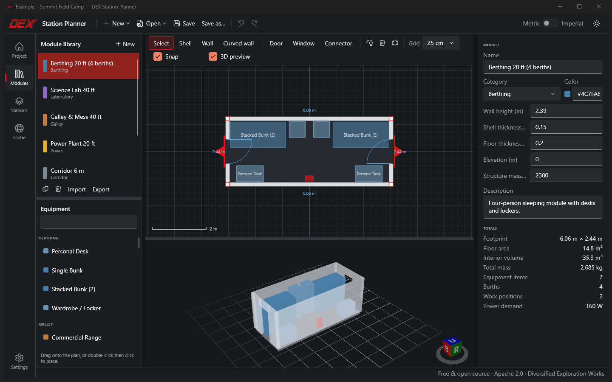
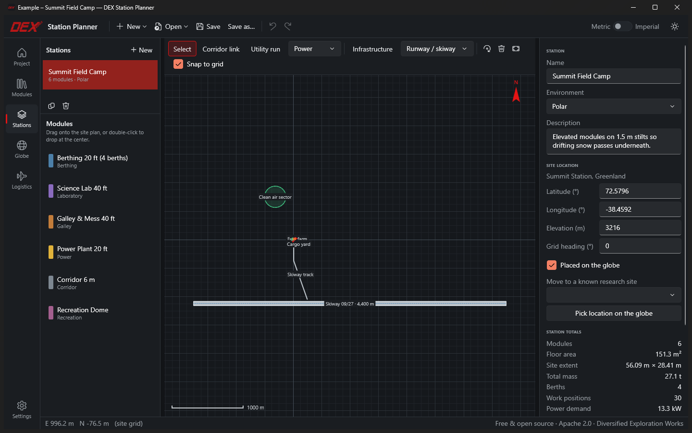
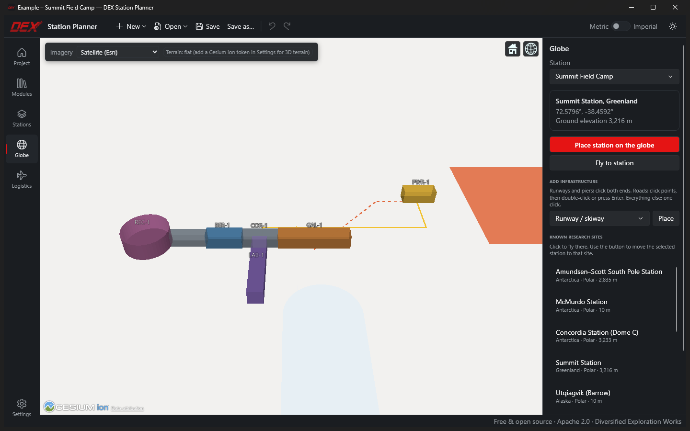
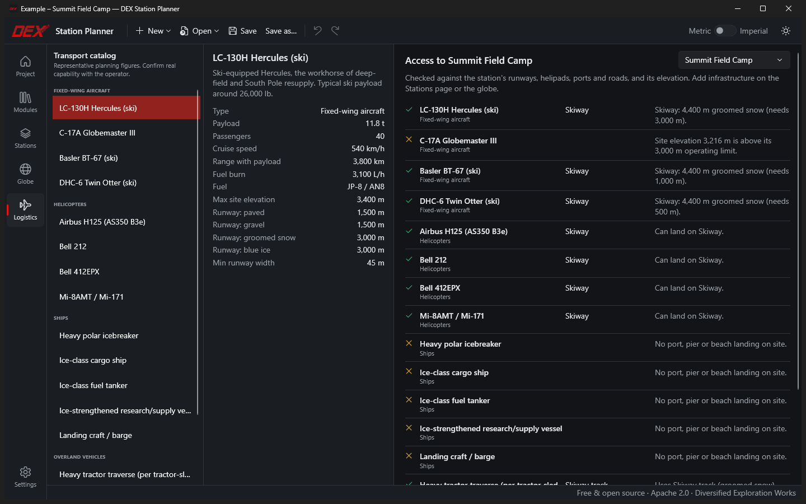

<p align="center">
  
</p>

# DEX Station Planner

**Free, open-source planning software for remote research stations**, from Diversified Exploration Works.

Design station modules on a floor-plan grid, assemble them into stations, and place them on a 3D globe.
The goal is a single **Generate** button that produces the full document package a station proposal needs
(design schematics, logistics and operations plans, budgets) for funders, the NSF, partners and operators.
Logistics simulation (airfields, ports, helipads, and science cargo moving in and out) will follow.

Terrestrial sites are supported today; extraterrestrial sites are on the roadmap.



## What it does today (v0.2, Milestones 1–2)

**Module designer**
- Start from ISO 10/20/40 ft and 40 ft high-cube containers, rectangles, round/dome, capsule, hexagon or octagon shells, or draw your own.
- Straight **and curved** walls: drag a wall's midpoint handle to bend it, double-click to add a corner.
- Doors, windows, hatches and vents cut into any wall; connectors mark where modules join.
- Drag-and-drop from a catalog of 50+ pieces of station equipment (berthing, galley, lab, medical, power, mechanical, comms, safety), each with size, mass and power data.
- Elevation above ground: modules on stilts for drifting snow.
- Live 3D preview with see-through walls.
- Live totals: footprint, floor area, volume, mass, berths, work positions and power.

**Station builder**
- Drop modules onto a site plan. Connectors **snap** together and link automatically.
- Corridor links between distant connectors.
- Utility runs (power, fuel, water, wastewater, heat, data) with draggable routes.
- Station totals: area, mass, berths, power demand/supply/margin, corridor and utility lengths.

**Site infrastructure & logistics**
- Place runways/skiways, helipads, ports/piers/beach landings, roads and tracks, fuel farms, cargo yards and science sites, on the site plan or by clicking the globe (runways by both ends; works kilometers from camp, including near the poles).
- Transport catalog: LC-130H, C-17A, Basler BT-67, Twin Otter, H125, Bell 212/412, Mi-8, polar icebreaker, ice-class cargo ship and tanker, research/supply vessel, landing craft, tractor traverse, over-snow vehicles and trucks.
- Compatibility checks with plain-language reasons: runway surface, length and width; helipad size; berth depth and length; road surface; site elevation limits. Shown per feature and on the Logistics page.

**Globe**
- CesiumJS globe that works **without any account**: free Esri satellite or OpenStreetMap imagery over a bundled offline base layer that covers the poles.
- Click to place a station, or jump to known sites (South Pole, McMurdo, Concordia, Summit, ALMA, Mauna Kea…).
- Optional Cesium ion token (Settings) adds 3D terrain and Bing imagery.

**General**
- Dark and light themes with DEX branding; metric or imperial display (SI stored internally).
- Undo/redo for everything, crash-safe saves, recent files.
- Projects are human-readable JSON (`.dexstation`); modules can be shared as `.dexmodule` files.





## Getting started

### Requirements
- Windows 10 (1809+) or Windows 11
- [.NET 10 SDK](https://dotnet.microsoft.com/download)
- [Node.js](https://nodejs.org/) 18+ (the first build runs `npm ci` to fetch CesiumJS)
- Microsoft Edge WebView2 Runtime (included with Windows 11)

### Build and run
```powershell
git clone <this repository>
cd DEX-STATION-PLANNER
dotnet build
dotnet run --project src/DexStationPlanner.App
```
Run the tests with `dotnet test`.

Useful flags: `--example` opens the worked example station, and `--page Modules|Stations|Globe|Logistics|Settings` picks the start page.
A `.dexstation` path opens that project.

### Keyboard shortcuts
| Where | Keys |
|---|---|
| Anywhere | `Ctrl+N` new · `Ctrl+O` open · `Ctrl+S` save · `Ctrl+Z`/`Ctrl+Y` undo/redo · `Ctrl+1…5` switch page |
| Plans | Wheel zoom · middle-drag or `Space`+drag pan · drag empty space to pan · `Del` delete · `Esc` cancel |
| Module editor | `V` select · `S` shell · `W` wall · `A` curved wall · `D` door · `N` window · `C` connector · `R` rotate 90° (`Ctrl+R` 15°) · arrows nudge · `Shift` constrains to 45° · `Alt` disables snapping |
| Station builder | `V` select · `L` corridor link · `U` utility run · `F` infrastructure (`Enter`/double-click finishes a road) · `R` rotate · `Alt`+drag places without snapping |

## Project layout
```
src/DexStationPlanner.Core    Domain model, geometry, stats, meshes, serialization (no UI; fully unit-tested)
src/DexStationPlanner.App     WPF desktop app: editors, 3D preview, WebView2 + CesiumJS globe
tests/                        xUnit tests for Core
docs/                         Architecture notes, roadmap, brand assets
```
See [docs/ARCHITECTURE.md](docs/ARCHITECTURE.md) for conventions and design, and [docs/ROADMAP.md](docs/ROADMAP.md) for what's next.

## Contributing
Issues and pull requests are welcome. See [CONTRIBUTING.md](CONTRIBUTING.md).

## License
Apache License 2.0. See [LICENSE](LICENSE) and [NOTICE](NOTICE) (third-party components and map data attributions).
The DEX Works name and logo identify the project and are not licensed for other use.
